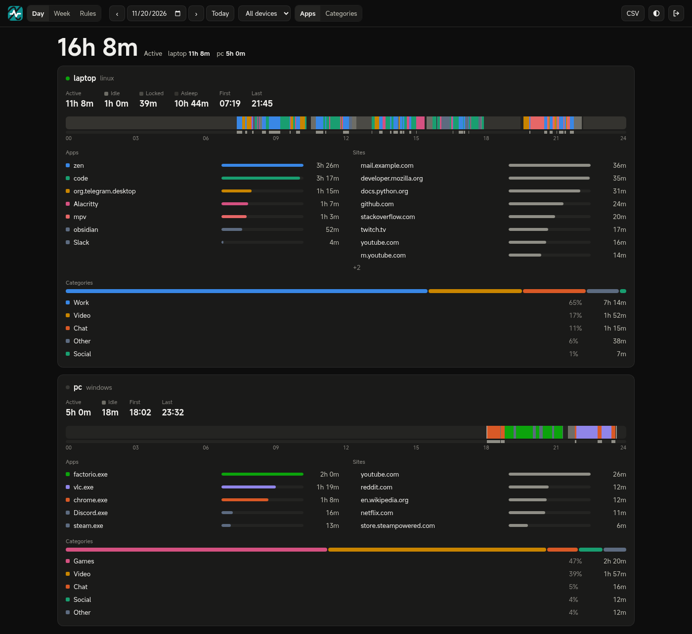
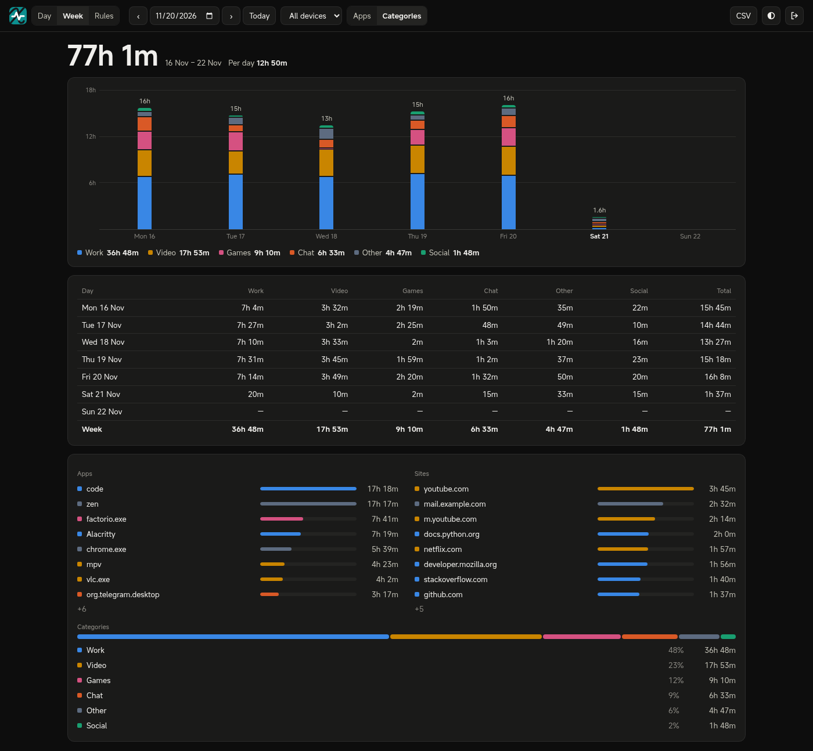
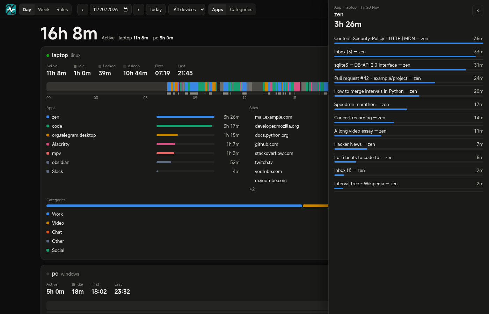
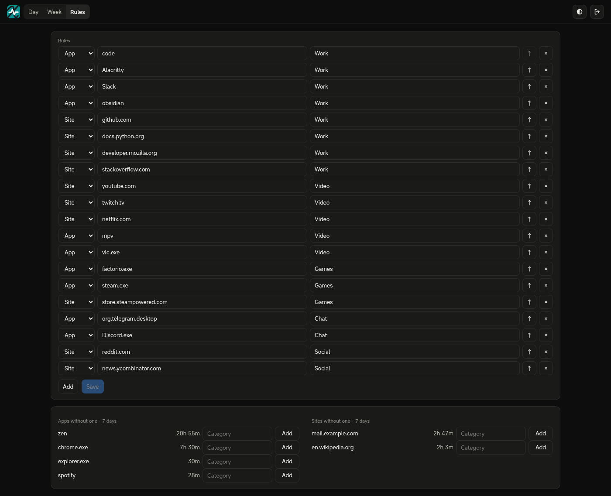
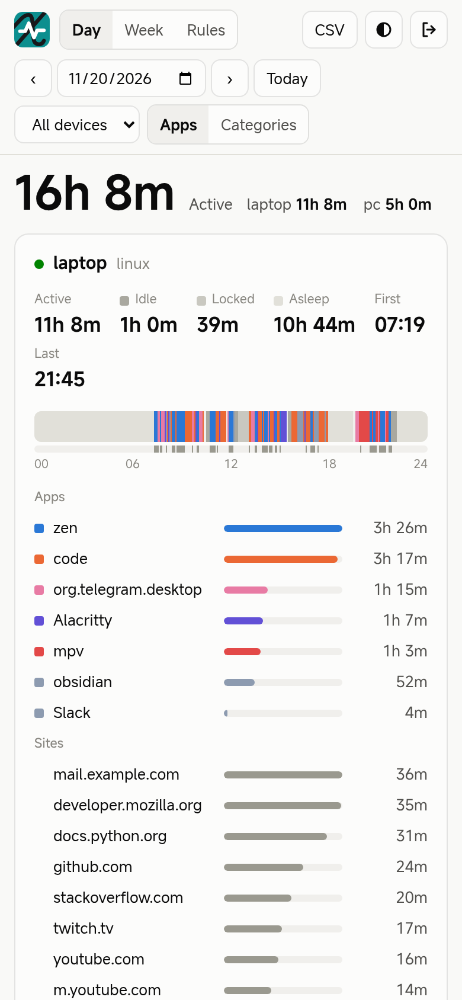

<p align="center">
  
</p>

<h1 align="center">xrnmoni</h1>

Self-hosted activity monitor for **machines you own**. Each machine runs a small
agent that records which app is in the foreground (and for how long), idle time,
boot/shutdown, and — via a browser extension — which web pages are open in real
time. Everything streams to one central server with a web dashboard you open
from anywhere on your network.

> **Scope / consent.** This is built for monitoring your own devices, or devices
> whose users know and consent (the parental-controls model). Don't deploy it
> covertly on another adult's machine — that's stalkerware and in many places
> illegal. There is intentionally no stealth/hide mode.

```
Windows PC ─┐                         ┌─ you (one browser tab)
            ├─ agent + extension ──┐  │
Linux laptop┘                      ▼  ▼
                            hub: server (Python + SQLite) + dashboard
```



*A day of two made-up devices: active, idle, locked and asleep time, the timeline (apps
and away time above, the browser's pages in the thin strip below; hover for what each
stretch was, click to open it), and the day's apps, sites and categories.*

## Layout

| Path          | What it is                                            |
|---------------|-------------------------------------------------------|
| `server/`     | The hub: `xrnmoni.py` (ingest + query API, SQLite store), the dashboard in `web/`, `deploy.sh`, `demo_server.py` |
| `agent/`      | Cross-platform agent (Windows + Linux): `agent.py`, `platform_linux.py`, `platform_win.py` |
| `extension/`  | MV3 browser extension for live page tracking (Chromium and Firefox/Zen) |
| `linux/`      | `install.sh` and the systemd user unit for the Linux agent |
| `windows/`    | Per-user Windows installer, start/stop/status scripts, the `.exe` build, and its guide |
| `scripts/`    | `package-extension.py` (the `.zip` and `.xpi`) |
| `tests/`      | Agent, bridge, extension and installer tests (the hub's own are in `server/`) |

---

## 1. Server (the hub: run once, on whichever machine is always on)

One Python file, `server/xrnmoni.py`, with the dashboard in `server/web/`. It needs
Python 3.10+ and `bcrypt`, nothing else, so it runs on Linux, Windows, or Termux on
an old Android phone (`pkg install python python-bcrypt`).

```bash
pip install -r server/requirements.txt              # just bcrypt
python3 server/xrnmoni.py user add alex --data ~/xrnmoni-data     # asks for a password
python3 server/xrnmoni.py token add laptop --data ~/xrnmoni-data  # prints a device token
python3 server/xrnmoni.py token add pc --data ~/xrnmoni-data
python3 server/xrnmoni.py --data ~/xrnmoni-data     # http://127.0.0.1:5240/
```

`--data DIR` holds everything: the database (`xrnmoni.db`, SQLite in WAL mode),
the device tokens, the category rules, the users file and, when there is no
console, the log (`xrnmoni.log`).

| Option | Default | |
|---|---|---|
| `--host` | `127.0.0.1` | `0.0.0.0` (or the machine's Tailscale address) to take other machines' agents directly |
| `--port` | `5240` | |
| `--users FILE` | `DIR/users` | an htpasswd file of bcrypt hashes, such as one other services on the same server already share |
| `--viewer NAME` | | another user in that file who may see the dashboard (give it once per user); the file's first user always may |
| `--prefix` | `/xrnmoni` | the path a reverse proxy publishes the hub under; paths work with or without it |
| `--retain-days` | `400` | events older than this are deleted, once a day; `0` keeps everything |
| `--web DIR` | `web/` beside `xrnmoni.py` | the dashboard's files |

**Logins.** The dashboard asks for a name and password from the users file
(`user add NAME`, `user remove NAME`, `user list`; the password can also be piped in).
It signs in with an `xrn_session` cookie (HttpOnly, SameSite=Strict, 30 days); ten
wrong passwords from one address lock it out for 15 minutes. Signing out ends that
cookie for good. With `--users` pointing at a users file other xrn services share,
they share the sign-in and sign-out too.

**Device tokens.** Each agent posts with its own token: put the one `token add NAME`
printed in that machine's agent config as `token`. The owner (the users file's first user)
can also make one on the dashboard's **Devices** page, which shows it once, and revoke it
there, so a new device needs no shell on the hub. A device token only posts events,
always under its own device's name, and reads nothing; `token list` shows them and
`token revoke ID` ends one at once. Only a hash of each is kept. The old single
`XRNMONI_TOKEN` (environment) still posts, under the name the agent sends, so
existing agents keep working until they get their own tokens.

**Reaching it.** The server speaks plain HTTP. On one machine, `127.0.0.1` is enough.
For other machines, either put it behind an HTTPS reverse proxy (it can publish it
under a path such as `/xrnmoni`, stripped or not), or listen on a Tailscale or
WireGuard address and use that. Don't expose the port to the internet without TLS.
A hub reached over plain HTTP from another machine gets a sign-in cookie without
`Secure`, since the browser would drop one with it.

**A Windows PC as the hub.** `pythonw server\xrnmoni.py --data <DIR>` runs it with no
console window; it then logs to `<DIR>\xrnmoni.log`. `windows\install.ps1 -WithHub`
installs it as a logon task beside the agent (section 8 of the
[Windows guide](windows/README-WINDOWS.md)).

**Deploying to a server.** `server/deploy.sh` installs or updates the hub on a
server reached over ssh that runs runit (Termux on Android, or any Linux with runit):
it tests, copies `xrnmoni.py` and `web/` together, writes the run file, restarts the
service and waits for `/health`. Its settings (host, folder, port, users file, a
publish command for the proxy) go in `server/deploy.local`, which git ignores; start
from `server/deploy.local.example`. `server/runit/` has a run file to copy by hand
instead. Coming from the first (FastAPI) server, copy its `xrnmoni.db` into the data
folder before the first start: it is brought up to date in place.

**Trying it.** `python3 server/demo_server.py <empty folder> [--port N]` fills a hub with
two weeks of a made-up laptop's and PC's days, prints the address and a sign-in, and
keeps posting as the laptop every few seconds so the live view moves (`--no-live` stops
that). The screenshots in this README come from it. Delete the folder afterwards.

## The dashboard

- **Day**: every device with a timeline of the day (apps, idle, locked, asleep, and
  the browser's pages below), active time, first and last active moment, top apps and
  sites, the split by category, and what it's doing now with how long ago it was last
  heard from. It follows new events as agents post them.
- **Week**: a column per day stacked by device (or by category), the same figures as a
  table, and the week's apps, sites and categories.
- Any app, site or category opens to the window titles or pages behind it.
- **Rules**: category rules (an app's name or a site, first match wins, `*` and `?`
  allowed, a site matching its subdomains too), and the week's apps and sites without one.
- **CSV** of the day or week shown, times in the viewer's time zone.
- One device or all of them (the picker), colours by app or by category, a light and a
  dark theme, and a layout that works at phone width. The view, date, device and colouring
  are in the address, so a link opens the same view.

Days are the viewer's own: the page sends its local midnights. Time counts as active
when an app or page is in front and the device isn't idle, locked or asleep, so a page
left open while nobody is there doesn't count.



*The week, coloured by category.*



*Clicking an app opens the window titles behind it; a site opens its pages, a category its
apps and sites.*



*Category rules, first match wins, with the week's apps and sites that have none below,
each with a field to give it one.*



*The same day at phone width, light theme.*

## Security

- The dashboard puts everything agents send in as text, never as HTML (window and page
  titles are chosen by whatever app or website was open), and runs under a
  Content-Security-Policy that allows only its own files and requests to this server.
- Reads need a viewer's password or session; device tokens only post. Wrong
  passwords and tokens count towards a per-address lockout, and writes from another
  site's page are refused.
- The agent's browser bridge (`127.0.0.1:8129`) accepts posts only from the extension
  origins listed in `bridge_origins` that send the shared `bridge_secret`, so neither
  websites you visit, other extensions nor other local programs can feed it made-up
  activity. It checks every field and answers 400 to anything malformed. Page addresses
  are kept without their `?query` and `#fragment` unless `keep_url_query = true`.
- There is no stealth mode: the agent is an ordinary process or service, listed by the
  system like any other, and the extension shows in the browser's extension list.

## 2. Agent (on each monitored machine)

**Linux** (systemd user service):

```bash
linux/install.sh
```

It makes a venv (`agent/.venv`), copies the example config to
`~/.config/xrnmoni/agent.toml` if there is none (with a fresh `bridge_secret`, which it
prints for the extension), and installs and enables the user unit
`xrnmoni-agent.service`. The unit starts with the graphical session and stops with it
(`WantedBy`/`PartOf=graphical-session.target`), so Hyprland's and Wayland's sockets are
there when it starts; it restarts on a crash. Edit the config, then
`systemctl --user start xrnmoni-agent`; the log is
`journalctl --user -u xrnmoni-agent -f`. Run `install.sh` again after pulling to
update; it keeps the config and restarts the agent.

**By hand** (any platform):

```bash
cd agent
python -m venv .venv && . .venv/bin/activate      # Windows: .venv\Scripts\activate
pip install -r requirements.txt
cp config.example.toml config.toml                # then edit server_url + token + device
python agent.py --config config.toml
```

Set `server_url` to the hub's address (e.g. `http://192.168.1.10:5240`), or a URL with
a path if the hub sits behind a proxy (`https://host/xrnmoni`), and `token` to a device
token from `python3 server/xrnmoni.py token add <device> --data DIR` on the hub.
`device` is the friendly name shown in the dashboard.

**What it records, and how it survives trouble**

- The foreground window (`app`), idle time (`idle`: no input for `afk_threshold`
  seconds), the locked screen (`locked`) and sleep (`sleep`). One at a time: sleep
  beats locked, locked beats idle, idle beats the window.
- A private browser window (its title says Private Browsing, Incognito, InPrivate or
  (Private)) is kept as its app and its time with the title `Private`, never the page.
  The extension does the same for a private window's tabs when it is allowed in them:
  their time counts under the site `Private`, with no address or title.
- Intervals are sent as closed chunks of at most 60 s while they last, and split at
  local midnight, so a long stay shows up within a minute and day totals add up.
- Every event goes into a SQLite spool (`spool_path`, default
  `~/.local/state/xrnmoni/spool.sqlite`, `%LOCALAPPDATA%\xrnmoni\` on Windows) when it
  is made, and is deleted only after the server took it. A server outage, a restart or
  a crash loses nothing but the current minute; SIGTERM (systemd stop), Ctrl-C and
  SIGHUP close the open interval first. Each event has an id, so a resend is not
  counted twice. Events the server refuses are logged and dropped; the spool is
  capped by `spool_max_days` / `spool_max_rows`, oldest first.
- A suspend (or the agent being stopped) is noticed when the loop wakes to more wall
  time than it slept: the gap is recorded as `sleep`, not as time in the last window.
  A clock that counts through suspend but not clock changes (`CLOCK_BOOTTIME` on
  Linux, `GetTickCount64` on Windows) must see the gap too, so setting the clock
  forward ends the interval without inventing a sleep.

**Platform notes**

- **Windows** — foreground app, idle and the lock screen through the Win32 API (no
  extra packages). Install with `windows\install.ps1`; see
  [`windows/README-WINDOWS.md`](windows/README-WINDOWS.md).
- **Linux / Hyprland (Wayland)** — the focused window comes from Hyprland's event
  socket, so even short switches are seen; auto-detected, also when the agent started
  before Hyprland. Idle comes from the Wayland idle protocol (ext-idle-notify): the
  agent asks the compositor to tell it after `afk_threshold` seconds without input. It
  only listens and never keeps the screen awake; a video that keeps the screen on
  counts as being there. The lock screen is seen through logind and Hyprland's
  lock-notify protocol (hyprlock, the Omarchy/Quickshell lock, swaylock), and sleep
  through logind. The log's first lines say which sources are in use.
- **Linux / X11** — active window via python-xlib. For idle detection, install
  `xprintidle` (`sudo pacman -S xprintidle` on CachyOS/Arch); without it the agent
  falls back to logind's idle hint, which many desktops never set.
- **Other Wayland (GNOME/KDE)** — compositors don't expose the active window to
  unprivileged clients; the agent logs "unknown". Use an X11 session, or extend
  `platform_linux.py` with a GNOME-extension / KWin-script bridge. Idle works where
  the compositor has ext-idle-notify (KDE does).

**Run it on boot**

- Linux: `linux/install.sh`, above.
- Windows: `windows\install.ps1` sets up a per-user logon task (see [`windows/README-WINDOWS.md`](windows/README-WINDOWS.md)).

## 3. Browser extension (for live website tracking)

The extension reports the active tab's URL/title/time to the agent on
`127.0.0.1:<bridge_port>` — so the agent must be running on that machine. It
never holds the server URL or token. It follows tab switches, page loads and window
focus, and stops the interval when the browser reports the machine idle (60 s) or
locked. It has no toolbar popup: everything is on its options page (*Port*, *Secret*,
the extension's *Origin* to copy into `bridge_origins`, and *Last post*).

**Chrome / Edge / Brave**

1. `chrome://extensions` → enable *Developer mode*.
2. *Load unpacked* → select the `extension/` folder.
3. Open the extension's options: set *Secret* to `bridge_secret` from the agent's
   config (and *Port* if you changed `bridge_port`), then *Save*.
4. The manifest's public `key` gives the extension the same id everywhere,
   `jiogollbnlahboaadnimlllpohpmgnaa`, and the example config already lists
   `chrome-extension://jiogollbnlahboaadnimlllpohpmgnaa` in `bridge_origins`. An origin
   that isn't listed is refused, and the agent logs `[bridge] refused …` once with the
   origin to add. *Last post* on the options page shows what the agent answered
   (200 = recorded).

**Zen / Firefox** — the same folder works: the manifest names both a service
worker (Chromium) and an event-page script (Firefox), and has a fixed add-on id.

- Try it: `about:debugging` → *This Firefox* → *Load Temporary Add-on* → pick
  `extension/manifest.json` (gone after a restart).
- Keep it: `python scripts/package-extension.py` writes
  `dist/xrnmoni-extension-<version>.xpi` (and a `.zip` for Chromium). It is unsigned,
  so set `xpinstall.signatures.required` to `false` in `about:config` (Zen, Firefox
  Developer Edition, Nightly and ESR honour it), then drag the `.xpi` onto the
  browser. A newer version is installed the same way.
- Then set the secret as for Chromium, and add the origin to `bridge_origins`:
  Firefox's is `moz-extension://<uuid>`, different in every profile (the options
  page shows it). The add-on id is `xrnmoni@xrnmoni`.

Tests: `python -m unittest discover tests` covers the manifest and the package;
with Playwright installed, `tests/test_extension_chromium.py` also loads the
extension in headless Chromium and checks its posts reach the agent's bridge.

MV3 service workers can be suspended; a 30-second heartbeat chunks long sessions
so at most ~30s is ever lost on suspension.

## Tests

```bash
pip install -r server/requirements.txt -r agent/requirements.txt
python -m unittest server/test_xrnmoni.py     # the hub: API, logins, tokens, rules, retention
node --test server/test_web.mjs               # the dashboard's local dates, in zones either side of UTC
python -m unittest discover tests             # agent, spool, tracker, bridge, extension, installers
```

`tests/test_extension_chromium.py` runs only with Playwright installed. CI
(`.github/workflows/ci.yml`) runs all three on Ubuntu and Windows, and installs the
Windows agent end to end on a real Windows runner: every PowerShell script parses under
Windows PowerShell 5.1; the per-user install and its logon task; the agent's events and
browser-bridge posts reaching a hub behind a front that strips `/xrnmoni`; stop, start and
uninstall; and the `xrnmoni-agent.exe` build, installed with `-UseExe` and kept as the
`xrnmoni-windows` artifact.

## Limits

- Agents exist for Windows and Linux only; there is none for macOS, Android or iOS.
- On Wayland other than Hyprland (GNOME, KDE), the foreground app is "unknown" (see the
  platform notes).
- Web pages are recorded only in browsers with the extension, and only while the agent
  runs on the same machine. Firefox and Zen give the extension a different origin in each
  profile, so each needs adding to `bridge_origins`.
- The hub speaks plain HTTP; TLS comes from a proxy or a private network in front of it.
- The dashboard reads at most 62 days at a time (400 for the CSV export), and the hub
  keeps 400 days unless `--retain-days` says otherwise.

---

## Data model

All events land in one `events` table. Each carries an `id` (32 hex characters)
that the agent gives it, and intervals are at most 60 s long:

| type       | meaning                                    | fields used                     |
|------------|--------------------------------------------|---------------------------------|
| `app`      | foreground window interval                 | app, title                      |
| `web`      | active-tab interval (from the extension; the agent sends `browser`) | url, title, domain |
| `idle`     | no input for `afk_threshold` s (was `afk`) |                                 |
| `locked`   | the screen locked                          |                                 |
| `sleep`    | machine asleep, or the agent not running   |                                 |
| `boot`     | machine boot time (a point: no end)        |                                 |
| `shutdown` | agent stopping (a point)                   |                                 |

Each has `ts_start` and `ts_end` (epoch seconds). The first agent's `browser` and
`afk` are stored as `web` and `idle`; any other type is kept and shown under its own name.

## API

`GET /health` (and `/healthz`) answer without a login. Every path also works under
`/xrnmoni/`.

### Ingest

`POST /api/events` with `Authorization: Bearer <device token>`:

```json
{"device": "laptop", "os": "linux", "events": [
  {"id": "9b1c0e0d6f2a4b7e8c3d5a1f0e2b4c6d", "type": "app", "app": "code", "title": "main.py",
   "url": null, "domain": null, "ts_start": 1795100000.0, "ts_end": 1795100030.0, "duration": 30.0}
]}
```

- `id` is the agent's UUID (32 hex digits; dashes and capitals are ignored). An event
  whose id is already stored is skipped, so a batch can be sent again safely. Events
  without an id are taken as before.
- Per event: `ts_start` is required, a number, not before 2000 nor more than a day
  ahead; `ts_end` (or `ts_start + duration`) not before it and at most 7 days later;
  `type` lower-case letters, digits, `_` or `-`; text fields are strings (cut to
  200 characters for `app`, 1000 for `title`, 4000 for `url`).
- Up to 10,000 events and 8 MB per post; `Content-Encoding: gzip` is accepted.

A well-formed batch is answered `200` even if some events in it fail their check:

```json
{"ok": true, "inserted": 41, "duplicates": 2,
 "rejected": [{"index": 7, "id": "9b1c0e0d6f2a4b7e8c3d5a1f0e2b4c6d", "error": "ts_start must be a number"}]}
```

`rejected` lists the events that were not stored, by their place in the batch; drop
them, don't send them again. A batch is refused whole only when it is malformed:
`400` (not a JSON object, `events` not a list, too many events, no `device` with the
old shared token), `401` (wrong or revoked token), `413` (too large), `429` (locked
out; `Retry-After` says for how long).

### Reads

Sign in with `POST /api/session` (Basic auth and an `X-Xrn-Client` header; sets the
cookie), send the cookie with `X-Xrn-Client` afterwards, or send Basic auth with every
request. `DELETE /api/session` signs out. Times are epoch seconds; each read takes
`device=` for one device.

| | |
|---|---|
| `GET /api/devices` | each device, when it was last heard from, and `now`: what it's doing |
| `GET /api/day?since=&until=` | per device: `active`, `totals` by type, `apps`, `sites`, `categories`, `first`, `last`, and the timeline (`segments`, `web`, `marks`; `timeline=0` leaves it out) |
| `GET /api/days?bounds=t0,t1,…` | per day (`t0`–`t1`, `t1`–`t2`, …) and device: active time, totals, categories, top apps and sites |
| `GET /api/detail?since=&until=&app=` | an app's window titles with time; `site=` a site's pages; `category=` a category's apps and sites |
| `GET /api/activity?since=&until=` | the events themselves, newest first (`limit=`, up to 20,000) |
| `GET /api/export?since=&until=&tz=` | the same as CSV, times in zone `tz` |
| `GET /api/summary?device=&since=&until=` | the first server's per-device totals |
| `GET /api/categories` | the category rules; `ETag` is their version |
| `PUT /api/categories` | `{"rules": [{"kind": "app" or "site", "pattern", "category"}]}`; needs `If-Match` (`428` without, `412` if changed) |
| `GET /api/changes?seq=&wait=` | answers `{"seq"}` as soon as an agent posts, or after `wait` seconds (at most 30) |
| `GET /api/tokens` | the owner only: each device token's `id`, `device`, `created` and the device's `last_seen` (never the token) |
| `POST /api/tokens` | the owner only: `{"device"}` makes a token, answered `{"id", "device", "token"}` this once |
| `DELETE /api/tokens/<id>` | the owner only: revokes one at once |
| `GET /api/downloads` | a viewer, **or a device token**: the files in `DIR/downloads` with `kind`, `size`, `sha256` and an `href` that fetches it without a login for an hour |

A range is at most 62 days (400 for the export). `GET /get` is the downloads page, which
opens with a viewer's sign-in or with the device token the new device will post with, so
the owner's password is never typed on a monitored device.

## Roadmap / easy extensions

- Screenshots on an interval (add a `screenshot` event type + static file store).
- Alerts (notify when a device uses X for more than N minutes).
